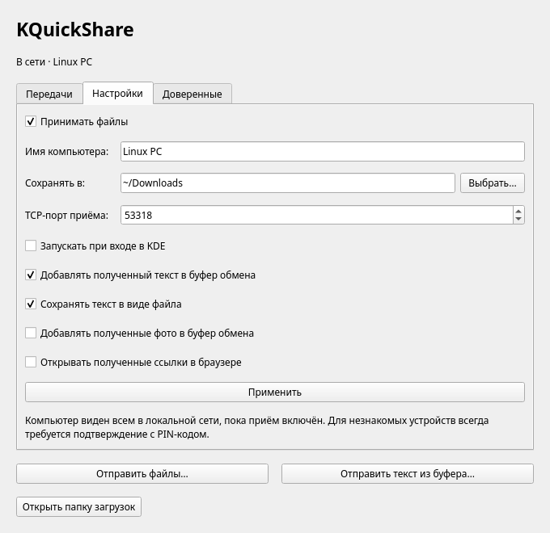

# KQuickShare

[English](README.md) · **Русский**

Нативное приложение Google Quick Share / Nearby Share для Linux и KDE Plasma 6.
Телефон отправляет файлы штатной кнопкой **Поделиться → Quick Share**; приложение
работает в системном трее. Дополнительная программа на Android не нужна.

> **Это вайбкод-проект.** Приложение разрабатывалось с помощью ИИ-агентов,
> а владелец проекта проверял его работу на Arch Linux / KDE и реальном Android-телефоне.

## Дистрибутивы и совместимость

Основное приложение рассчитано на **Plasma 6**, Qt **6.8+** и KDE Frameworks **6.0+**.
Установщик определяет семейства Arch, Debian/Ubuntu, Fedora и openSUSE.
Сборка и автоматические проверки выполняются на Arch, Debian 13 и Fedora 43;
Ubuntu 26.04 включена в CI. С настоящим телефоном пока в основном проверяли
Arch / Plasma 6.8 / Pixel 7 Pro. Plasma 5 не поддерживается.

[Что именно проверено, версии KDE и брандмауэр](docs/COMPATIBILITY.md) ·
[Сообщить о проблеме](https://github.com/jjjadeRRR/kquickshare/issues/new/choose)



В [Releases](https://github.com/jjjadeRRR/kquickshare/releases) есть исходники
и пакеты для конкретных дистрибутивов. Выбирайте пакет своей системы: Debian `.deb`
не является универсальным пакетом Ubuntu, а Fedora RPM — пакетом openSUSE.
Если подходящего пакета нет, используйте установку из исходников ниже.

## Возможности

- Значок и меню Plasma через KStatusNotifierItem; закрытие окна оставляет приёмник в трее.
  Значок приложения окрашивается в акцентный цвет Plasma.
- Уведомления KDE с действиями «Принять» и «Отклонить», PIN в уведомлении и карточке передачи.
- Явное добавление устройства в доверенные и автоматический приём при следующей передаче.
- Сохранение в папку «Загрузки» (`xdg-user-dir DOWNLOAD`) или в выбранную папку, автозапуск при входе, приостановка приёма, прогресс и отмена.
- Несколько файлов, пустые файлы, текст и ссылки (открываются автоматически, если включить настройку).
- Полученный текст автоматически добавляется в буфер обмена. Фото сохраняются в Downloads.
- Шифрование UKEY2 / P-256 / AES-256-CBC / HMAC-SHA256.
- Запись в скрытые временные файлы `.kquickshare-*.part`; публикация после проверки полного размера.
  Существующие файлы не заменяются: создаются имена `file (1).ext` и далее.
- Очистка незавершённых файлов после ошибки/отмены/выхода, таймауты, keep-alive,
  повторный запуск обнаружения после изменения сетевых интерфейсов.

## Полученный текст

На вкладке **Настройки** доступны два независимых переключателя:

- **Добавлять полученный текст в буфер обмена**.
- **Сохранять текст в виде файла**.
- **Добавлять полученные фото в буфер обмена** (по умолчанию выключено).
- **Открывать полученные ссылки в браузере**, только http и https (по умолчанию выключено).

По умолчанию включены оба. Нажмите **Применить**, чтобы сохранить выбор.
Текстом считается сообщение Quick Share (включая «Поделиться» скопированным
текстом на Android), а также корректный UTF-8 файл `.txt` до 5 МиБ.
Если сохранение текста выключено, такой `.txt` не остаётся в Downloads.
Если выключены обе настройки текста, полученный текст отбрасывается.
Другие файлы и фото всегда сохраняются в папку «Загрузки».

Буфер меняется только после успешной передачи текста. При нескольких текстовых
вложениях в нём остаётся последнее обработанное. Фото сохраняются в Downloads
и не меняют буфер обмена. Некорректные или слишком большие `.txt` сохраняются
как обычные файлы.

## Отправка на телефон

- В Dolphin: выделите один или несколько локальных файлов → правая кнопка →
  **Отправить на телефон через KQuickShare…**.
- В приложении и меню трея: **Отправить файлы…** или **Отправить текст из буфера…**.
- В истории буфера (после установки дополнительной интеграции ниже): наведите
  мышь на текстовую запись и нажмите кнопку отправки рядом с прежними действиями.

Откроется окно с QR-кодом и списком телефонов. Сканируйте QR камерой Android,
откройте ссылку Quick Share, выберите появившийся телефон и нажмите «Отправить».
При необходимости подтвердите приём на телефоне. Устройства должны быть в одной
LAN; Bluetooth-адаптер не обязателен. Альтернатива QR — экран приёма в Files by Google.
Текст отправляется как текст Quick Share, файлы — как файловые вложения.
При ошибке можно повторить попытку в том же окне; автоматических повторов нет.

## Пакет Arch Linux

В репозитории есть `packaging/PKGBUILD`: он скачивает исходники указанного релиза
с GitHub и проверяет SHA-256. После проверки рецепта:

```sh
cd packaging
makepkg -si
```

В AUR пакет пока не опубликован. Репозиторий:
https://github.com/jjjadeRRR/kquickshare

## Установка из исходников одной командой

Скачайте и распакуйте архив исходников из [Releases](https://github.com/jjjadeRRR/kquickshare/releases),
откройте терминал в распакованной папке и выполните:

```sh
./install.sh
```

Установщик определит дистрибутив, проверит зависимости и предложит установить недостающие
через пакетный менеджер с помощью sudo. Затем соберёт приложение, установит его в `~/.local`
и запустит в текущем сеансе KDE. Сам скрипт запускайте от обычного пользователя,
без sudo. Пароль администратора может потребоваться только для установки зависимостей.

Приложение появится в меню KDE и трее. Автозапуск включается в настройках.
Закрытие окна оставляет приложение в трее; пункт «Выйти» останавливает его.
Повторный запуск `./install.sh` обновляет и перезапускает приложение — перед
обновлением завершите текущие передачи.

Язык выбирается по локализации системы: русский или английский; для остальных
языков используется английский. После смены языка рабочего стола перезапустите
KQuickShare.

Кнопка в истории буфера остаётся отдельной опцией для Plasma 6.8:

```sh
"$HOME/.local/share/kquickshare/integration/install-clipboard.sh"
systemctl --user restart plasma-plasmashell.service
```

Панель кратковременно перезапустится. Установка и удаление этой интеграции описаны
в `integration/README.md`. Установщик приложения не включает её автоматически.
Для системного Arch-пакета есть `packaging/PKGBUILD`; подробная ручная сборка и
параметры установщика — в [docs/BUILDING.md](docs/BUILDING.md).

## Первый приём

1. Подключите телефон и ПК к одной локальной сети. ПК может быть подключён кабелем.
2. Запустите KQuickShare. В настройках видно имя компьютера и состояние приёмника. Файлы сохраняются в `~/Downloads`.
3. На телефоне выберите файл → Поделиться → Quick Share → имя компьютера.
4. Сверьте PIN на обоих устройствах и подтвердите в уведомлении или окне приложения.
5. Для автоприёма отметьте «Доверять этому устройству в домашней сети» в карточке
   **перед** нажатием «Принять». Доверие можно отозвать на вкладке «Доверенные».

**Модель доверия:** сейчас совпадают имя, тип и IPv4-адрес отправителя.
Постоянный криптографический ключ телефона не проверяется: стандартный анонимный
обмен paired-key в этой реализации не обеспечивает такую идентификацию.
Имя и адрес можно подменить; включайте автоприём только в своей локальной сети.
При смене адреса DHCP потребуется новое подтверждение. Это ограничение явно
показано в приложении. Без добавления в список автоприём выключен.

## Если телефон не видит компьютер

- Устройства должны иметь возможность общаться внутри LAN. Гостевой Wi-Fi и
  client isolation на роутере могут запрещать это.
- Если включён firewall, разрешите для своей LAN входящий UDP 5353 (mDNS) и TCP-порт
  приёмника. TCP-порт выбирается при запуске; посмотреть его можно через
  `ss -ltnp | rg kquickshare`. Не отключайте firewall целиком.
- Приёмник работает по IPv4 LAN. Wi-Fi Direct, BLE, Интернет, контакты Google,
  автоматическое обнаружение через BLE пока не реализованы. Для отправки есть QR.
- В режиме «Не беспокоить» Plasma может скрыть уведомление; запрос остаётся
  в окне приложения, а значок трея требует внимания. Ожидание подтверждения — 2 минуты.

## Проверки

```sh
sudo pacman -S --needed python-cryptography
cmake -S . -B build -G Ninja -DBUILD_TESTING=ON -DBUILD_PLASMA_CLIPBOARD_TESTS=ON
cmake --build build
ctest --test-dir build --output-on-failure
python tests/fake_sender.py --binary build/kquickshare-cli -v
python tests/fake_receiver.py --binary build/kquickshare-send -v
```

`core-tests` проверяет кодек, криптографию и endpoint info. `gui-tests` работает
с отдельными настройками и D-Bus-сеансом: реальная зашифрованная передача из Python,
подтверждение в GUI, сохранение доверия, повторный автоприём и отклонение незнакомого
имени с того же IP. `fake_sender.py` — независимый отправитель на Python cryptography;
проверяет данные файлов, коллизии, пути, пустые файлы, LAST_CHUNK с данными, обрывы,
неверные смещения/размеры/подписи и текст.
`fake_receiver.py` независимо проверяет исходящую передачу файлов и текста,
отклонение запроса, повреждённую подпись, задержку завершения на получателе
и отмену после достижения 100%. `core-tests` также проверяет уже буферизованный
запрос подключения и отправку оставшихся данных перед сигналом завершения. `clipboard-tests` загружает модуль
Klipper через пользовательский import path и проверяет передачу полного выбранного
текста (с Unicode, кавычками и переносами) через D-Bus.
Эти проверки не заменяют проверку с конкретным Android-телефоном.

CLI — отладочный приёмник, **автоматически принимает все запросы**, без GUI-списка
доверия; не используйте его как повседневный фоновый сервис.

## Источники протокола

[NearDrop](https://github.com/grishka/NearDrop) и его
[описание протокола](https://github.com/grishka/NearDrop/blob/master/PROTOCOL.md).
Ядро написано на C++20 / Qt6 Network с OpenSSL 3; GUI использует Qt Widgets и KDE
Frameworks 6 без WebView. Подробности: `docs/architecture.md`, `docs/protocol.md`.

## Совместимость и лицензия

Проверено на Arch Linux, KDE Plasma 6.8 и Pixel 7 Pro: приём и отправка файлов,
отправка текста, пункт Dolphin и кнопка в истории буфера. Интерфейс автоматически выбирает русский или английский по локализации системы. Программа работает по локальной сети, без BLE и Wi-Fi Direct;
для исходящей передачи можно использовать QR. Программа не связана с Google или KDE.

GPL-3.0-or-later, см. [LICENSE](LICENSE). Необязательная интеграция буфера содержит
код KDE под GPL-2.0-or-later с исходными уведомлениями об авторстве;
подробности — [NOTICE.md](NOTICE.md).
